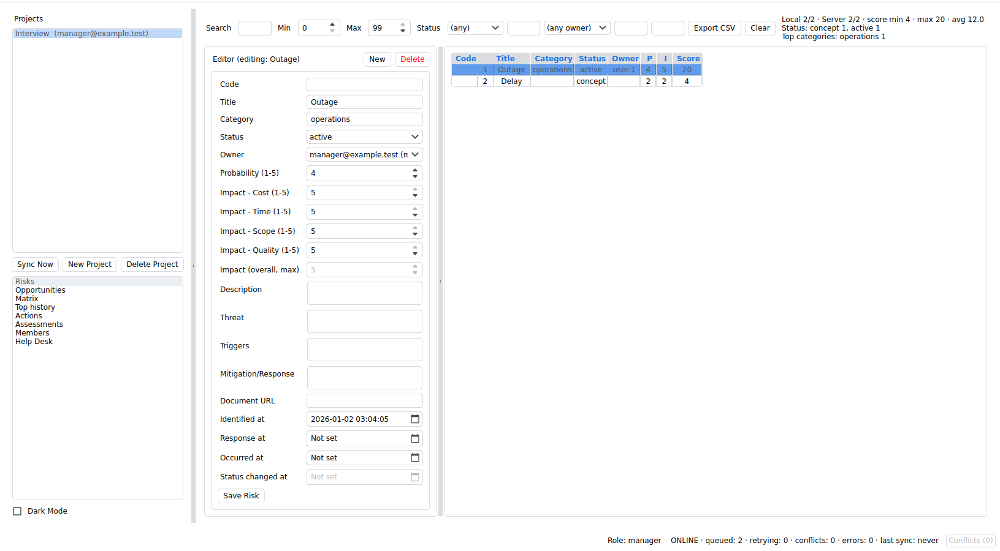
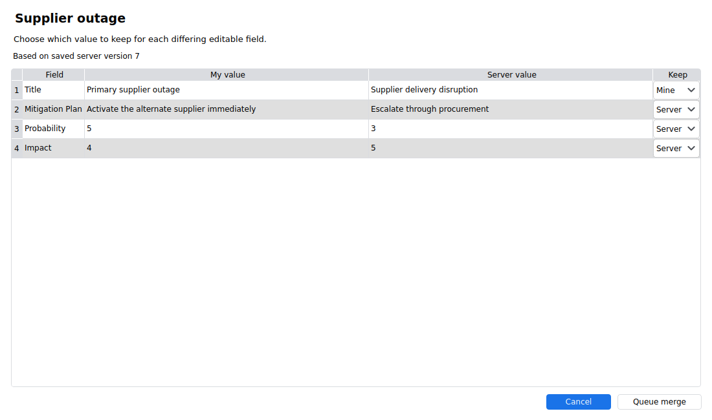

# Offline Risk & Opportunity Manager

[](https://github.com/Tomas-Skurla/risk-opportunity-manager/actions/workflows/ci.yml)
[](docs/SETUP_GUIDE.md#2-run-the-checks)
[](docs/SETUP_GUIDE.md)
[](LICENSE)

RiskApp is an offline-first risk and opportunity manager: a FastAPI/SQLAlchemy API and a PySide6 desktop client. Risk, opportunity, action, assessment and Help Desk edits use a local SQLite cache and persistent outbox. Account-associated work can synchronize in the background when the server is reachable; fully local work stays on the device.

## What this repository demonstrates

- Offline-first synchronization: a transactional outbox, idempotent server receipts, a per-project change sequence for pulls, and version checks that turn concurrent edits into explicit conflicts.
- A Conflict Center where the user keeps their copy, takes the server's, or merges field by field.
- Project roles enforced on both the REST and the sync paths.
- Argon2id passwords, hashed rotating refresh tokens, bounded request bodies and formula-safe CSV export.
- Client domain services with no Qt dependency, tested headless, plus mypy, Ruff, coverage gates and pinned dependencies in CI.

## Screenshots

### Risk workspace



### Field-level conflict merge



## Quick start

For Linux/WSL, install the OS packages from [the setup guide](docs/SETUP_GUIDE.md#1-install), then run from the repository root. Native Windows has separate [installation](docs/SETUP_GUIDE.md#windows-installation) and [startup](docs/SETUP_GUIDE.md#windows-startup) instructions:

```bash
bash scripts/setup_python_env.sh   # creates .venv from the pinned requirements
bash scripts/check_project.sh      # migrations, tests, mypy, Ruff
bash scripts/dev-init.sh           # private keys and an admin password in .env
bash scripts/run_server_dev.sh     # API at http://127.0.0.1:8000, this machine only
bash scripts/run_client_dev.sh     # desktop client, in a second terminal
```

Log in with `INITIAL_SUPERUSER_EMAIL` and `INITIAL_SUPERUSER_PASSWORD` from `.env`. The interactive API documentation is at `http://127.0.0.1:8000/docs`. To run the API in Docker instead, see [the setup guide](docs/SETUP_GUIDE.md#4-run-the-api-in-docker).

CI runs the same check, scans the repository for secrets and the built API image for vulnerabilities with Trivy, and starts the image to check `/health`. A separate workflow runs CodeQL on the Python source.

## Documentation

- [Architecture](docs/ARCHITECTURE.md): components, synchronization, schema, security and trade-offs
- [Setup guide](docs/SETUP_GUIDE.md): installing, running, Docker and configuration
- [Client](client/README_CLIENT.md): login and offline modes, roles and conflicts
- [Server](server/README_SERVER.md): accounts, API rules and administration
- [Manual test checklist](docs/TEST_GUIDE.md)
- [Demo rehearsal](docs/DEMO_REHEARSAL.md): offline edits, a conflict and a server restore, on Windows
- [Backup and restore](docs/BACKUP_RESTORE.md): SQLite snapshots and what clients need after a restore
- [Minikube runbook](deploy/MINIKUBE_RUNBOOK.md): the API on a local Kubernetes cluster
- [CodeQL](docs/CODEQL.md) and the [worker/backend contract](docs/WORKER_BACKEND_CONTRACT.md)

## Repository map

```text
client/       PySide6 application, domain services, local store, HTTP adapter
server/       FastAPI routers, auth/RBAC, persistence, sync
tests/        Headless client and API test suite
scripts/      Setup, checks, run, reset and dependency-lock workflows
deploy/       Kubernetes manifests for a local cluster
docs/         Guides and architecture
```

## License

RiskApp is licensed under the [MIT License](LICENSE).

RiskApp uses [PySide6 (Qt for Python)](https://doc.qt.io/qtforpython-6/) under the GNU Lesser General Public License v3.0. PySide6 and Qt are separate third-party works and are not covered by RiskApp's MIT License. This repository does not bundle PySide6 or Qt binaries; they are installed separately as dependencies.
